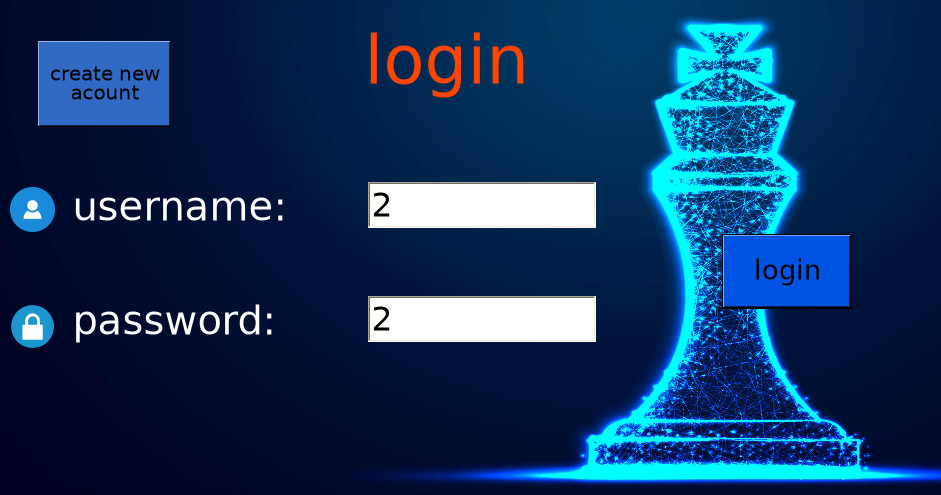
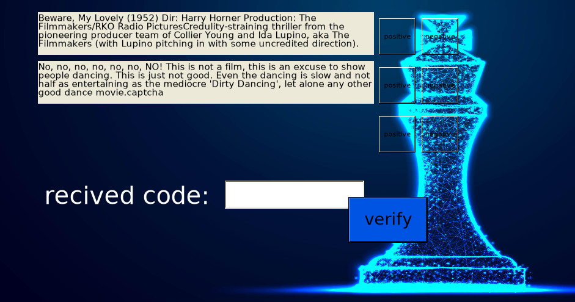
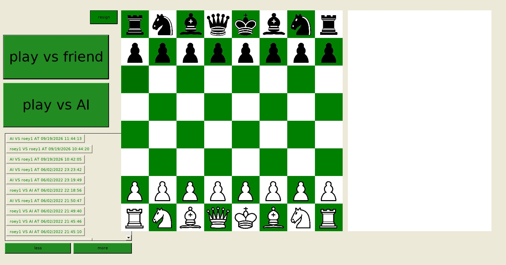
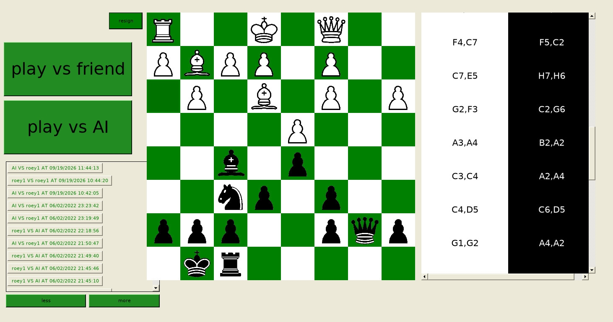

# chess-ui

A networked chess game. Players log in to a Windows desktop client, play each other or
the built-in AI, and can replay past games. The server runs in Docker alongside a SQL
Server database.

The chess rules and AI come from the vendored engine in [`chess-engine/`](chess-engine/).

## Screenshots

Login (username and password, with a "create new account" button):



Login is followed by a captcha step, which needs an emailed code and the captcha answers(write admin and click "varify" to bypass everything):



Main game screen. Choose "play vs friend" or "play vs AI", or pick a past game from the list:



A replayed game in progress. The move list on the right shows each move:



## Features

- **Accounts:** register, log in, and change password. Login is followed by an emailed
  confirmation code and a captcha check.
- **Play vs friend:** two logged-in players on the same server.
- **Play vs AI:** play against the engine's search.
- **Game history:** every finished game is saved to the database. Pick one from the list to
  replay it move by move.
- **Resign:** end a game early from the board screen.
- **Pawn promotion:** choose the piece when a pawn reaches the last rank.
- **Encrypted messages:** the server encrypts its messages to the client with RSA. Client-to-server
  messages are not encrypted yet (decryption is commented out in `ManageClients.cs`).

## Architecture

| Part | Folder | Tech | Runs on |
|------|--------|------|---------|
| Server | `chess air_Server/` | C# (.NET Framework 4.8), Mono | Docker (`mono:6.12`), port 500 |
| Database | `db/` | SQL Server 2022 | Docker, port 1433 |
| Desktop client | `chess air_client/` | C# WinForms (.NET Framework 4.7.2) | Windows, or Mono on Linux with a desktop session |
| Chess engine | `chess-engine/` | C# (.NET Framework 4.7.2) | Compiled into the server |

The database is seeded from `chess air_Server/DB.mdf` on first start. Its data is kept in a
Docker volume, so it survives restarts.

## Requirements

- Docker with the Compose plugin
- [`just`](https://github.com/casey/just) (the task runner used by this repo)
- Mono and `xbuild`, only for the desktop client
- A desktop session (`DISPLAY` or `WAYLAND_DISPLAY`), only for the desktop client

## Setup

1. Create the environment file and fill it in:

   ```sh
   just env
   ```

   Then edit `.env`:

   | Variable | Purpose |
   |----------|---------|
   | `DB_SA_PASSWORD` | SQL Server `sa` password. Must meet SQL Server's complexity rules (8+ characters, with upper and lower case, plus a digit or symbol). |
   | `DB_NAME` | Name the database is attached as. Defaults to `ChessDB`. |
   | `SMTP_USER`, `SMTP_PASSWORD` | Mail account the server uses to send login codes and captchas. |

2. Build and start the backend:

   ```sh
   just up
   ```

   This builds both images, starts them, and waits until the database reports healthy.

3. Check that everything is up:

   ```sh
   just smoke
   ```

   It confirms port 500 is reachable and that the seeded user table can be queried.

## Running the desktop client

```sh
just client
```

This starts the backend if it isn't running, builds the WinForms client with `xbuild`, and
launches `connect4_client.exe` from `chess air_client/bin/Release`.

The client connects to `127.0.0.1:500` (see `chess air_client/Program.cs`). To connect to a
server on another machine, change `ipAddress` there and rebuild.

## Common commands

| Command | What it does |
|---------|--------------|
| `just up` | Build and start the server and database |
| `just ps` | Show container status |
| `just logs server` | Follow the server log (use `db` for the database) |
| `just smoke` | Check the server port and the user table |
| `just shell-server` | Open a shell in the server container |
| `just sqlcmd` | Open a SQL session on the database container |
| `just down` | Stop containers, keep the database |
| `just clean` | Stop containers and delete the database volume |
| `just rebuild` | Delete everything and rebuild from scratch |
| `just client` | Build and start the desktop client |

## Project layout

```
docker-compose.yml        database and server services
justfile                  task runner recipes
db/                       SQL Server image and seed entrypoint
chess air_Server/         server: networking, DB access, game logic
  types of games/         1v1 and vs-AI game classes
chess air_client/         WinForms client: login, register, board
chess-engine/chess/       vendored chess engine (move generation, search, evaluation)
docs/images/              screenshots used in this README
```

## Troubleshooting

- **`db` never becomes healthy:** check `just logs db`. The usual cause is an `sa` password
  that doesn't meet SQL Server's complexity rules.
- **Login code email never arrives:** check `SMTP_USER` and `SMTP_PASSWORD` in `.env`, then
  `just logs server`.
- **Client window doesn't open:** make sure `DISPLAY` or `WAYLAND_DISPLAY` is set. The client
  is a GUI app and can't run in a container.
